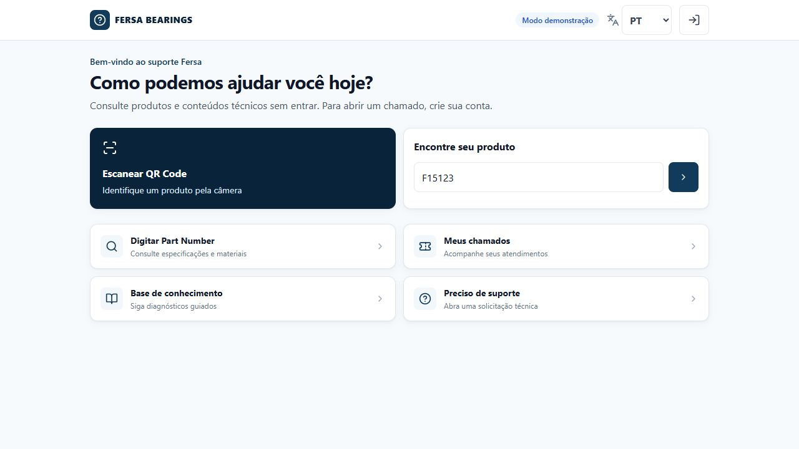
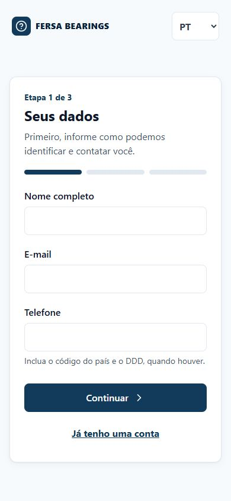
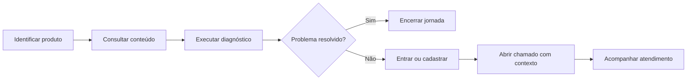
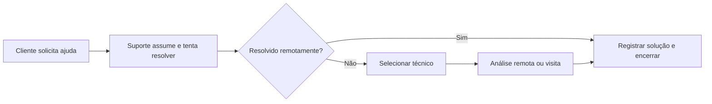
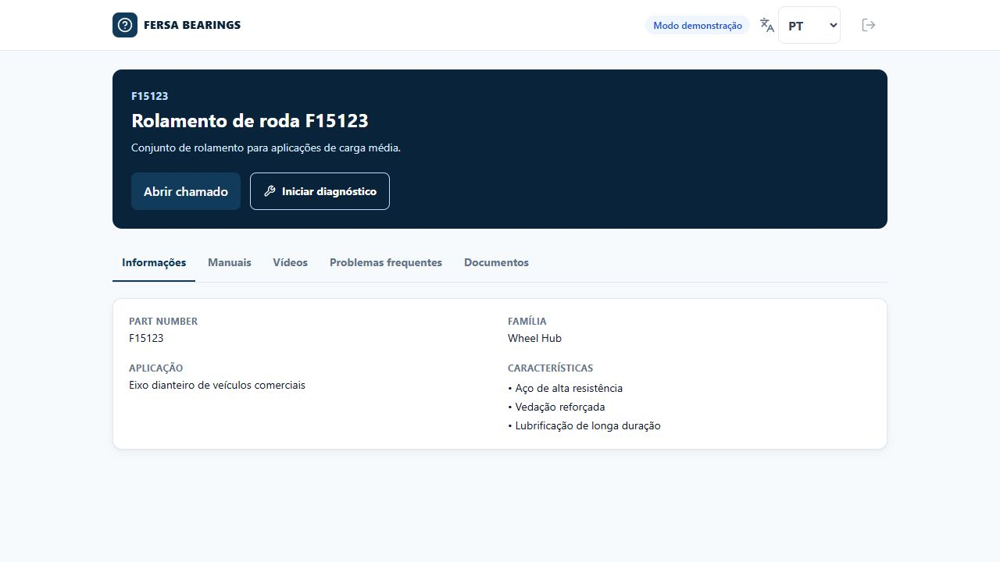
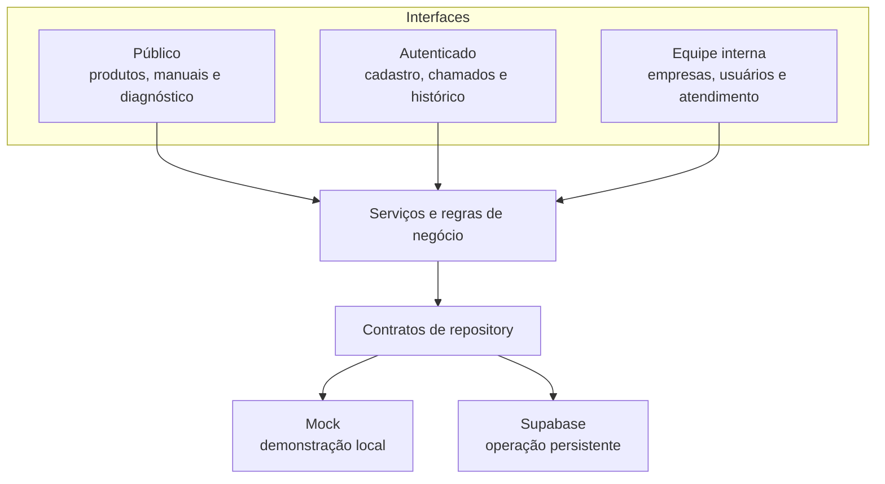
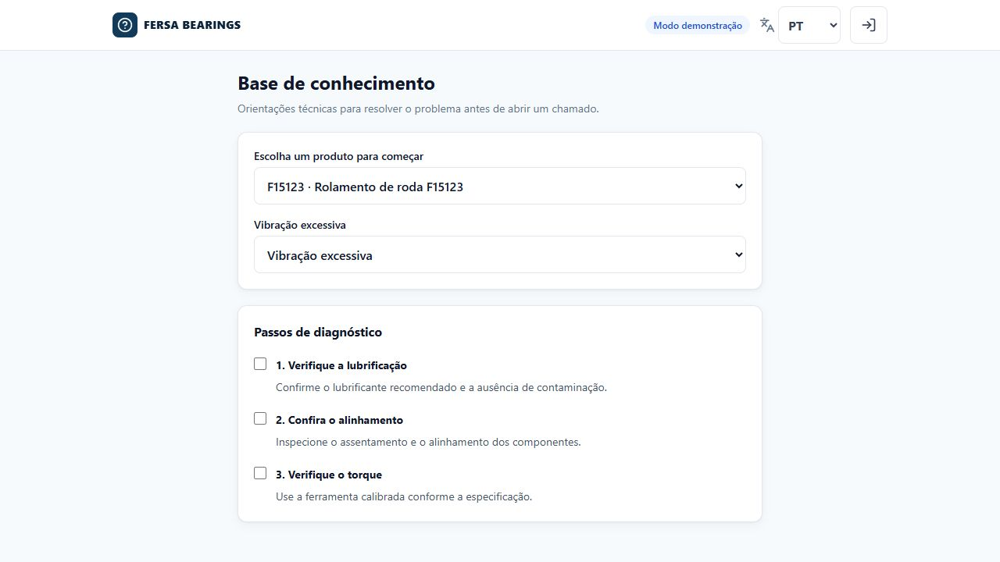

# Fersa Support

### Atendimento técnico simples, seguro e escalável

[Acessar demonstração](https://sistema-fersa.vercel.app/pt-BR) · [Página de apresentação](https://sistema-fersa.vercel.app/pt-BR/pitch) · [Baixar apresentação institucional](docs/Fersa-Support-Apresentacao-Institucional.pptx)

> [!IMPORTANT]
> Projeto demonstrativo e não oficial, desenvolvido como proposta de inovação para o pós-venda técnico. Marcas, produtos e fluxos apresentados servem exclusivamente para contextualizar o protótipo.



O **Fersa Support** é uma PWA multilíngue e mobile-first que conecta clientes, distribuidores, oficinas e a equipe técnica em uma única jornada. A plataforma reúne identificação de produtos, conteúdo técnico, diagnóstico guiado, abertura de chamados e acompanhamento do atendimento.

## Problema identificado

O desafio não está apenas em resolver um problema técnico. Antes disso, o cliente precisa localizar o produto correto, encontrar informação confiável, explicar o contexto e chegar ao canal adequado.

Os principais pontos de atrito considerados no projeto foram:

- identificação incompleta do produto, Part Number ou aplicação;
- conteúdo técnico, diagnóstico e chamados distribuídos em etapas desconectadas;
- baixa visibilidade do histórico e do status do atendimento;
- diferentes idiomas e níveis de familiaridade digital;
- dados insuficientes, que podem gerar retrabalho na triagem.

## Solução proposta

A proposta cria uma porta de entrada digital única para o pós-venda técnico:

- consulta pública por QR Code ou Part Number;
- catálogo, manuais e conteúdo técnico sem exigir login;
- diagnóstico guiado antes da abertura do chamado;
- cadastro progressivo, com rascunho preservado no navegador;
- abertura e acompanhamento de chamados para usuários autenticados;
- relacionamento entre usuário, empresa, produto e atendimento;
- área interna para consultar, priorizar e administrar empresas;
- interface sincronizada em português, espanhol e inglês.

<p align="center">
  
</p>

## Roteiro para o pitch

A rota `/pt-BR/pitch` (também em `/es/pitch` e `/en/pitch`) é uma página de apresentação dentro do próprio app: contexto da Fersa, problema, solução, jornada, demonstração ao vivo e proposta de piloto. Use `←` e `→` (ou um passador de slides) para avançar entre as seções.

Sugestão de demonstração em cerca de 5 minutos:

1. **Abertura:** `/pitch`, seções Início → A Fersa → Problema.
2. **Solução:** clique em _Abrir catálogo_, busque `Scania` e abra a ficha do F15097.
3. **Autoatendimento:** na ficha, _Iniciar diagnóstico_ mostra o checklist guiado.
4. **Cliente:** volte ao `/pitch#demo` e entre como _Cliente / oficina_; abra um chamado com contexto.
5. **Operação:** entre como _Equipe de suporte_, assuma o chamado e encaminhe a um técnico.
6. **Técnico e gestão:** entre como _Técnico de campo_ e depois _Gestão interna_ para ver fila e relatórios.
7. **Fechamento:** seção _Piloto_ com fases e indicadores a medir.

Os perfis de demonstração entram com um clique, sem digitar senha, tanto no `/pitch` quanto na tela de login.

## Jornada do usuário



O conteúdo técnico permanece público, enquanto chamados, anexos, histórico e dados da empresa exigem uma sessão válida.

### Fluxo interno de atendimento



O suporte preserva a responsabilidade pelo acompanhamento mesmo quando o caso é encaminhado. Mensagens, responsável, histórico, visita e solução permanecem na mesma solicitação. No modo demonstrativo, essas transições são persistidas no navegador e alimentam automaticamente as páginas de técnicos, visitas e relatórios.



### Exemplos do catálogo

Os dados demonstrativos usam referências públicas reais do portfólio Fersa — F400009, F15097, F15120, F200013 e F400012 — com aplicações e dimensões baseadas no [catálogo de Wheel End Units](https://www.fersa.com/uploads/files/catalogos/Fersa-WHU_EN-Wheel-end-units-CV.pdf) e na [faixa pública de produtos](https://www.fersa.com/en/product-range/wheel-end-hub-units-for-commercial-vehicles).

## Resultados esperados

Os ganhos de negócio são hipóteses a serem validadas em um piloto controlado:

- mais autonomia para consultas simples;
- chamados com contexto técnico mais completo;
- menor retrabalho antes da análise técnica;
- mais visibilidade do histórico do cliente;
- melhor experiência de uso em campo e no desktop.

Sem uma linha de base operacional, o projeto não promete percentuais. O piloto deve medir tempo de abertura, completude dos dados, casos resolvidos sem chamado e satisfação percebida.

## Metodologia

O desenvolvimento foi conduzido em quatro etapas:

1. **Descoberta:** levantamento de públicos, rotas, requisitos e riscos.
2. **Arquitetura:** separação do domínio, repositories e políticas de acesso.
3. **Implementação:** fluxos curtos, internacionalização, modo demonstrativo e integração Supabase.
4. **Validação:** testes automatizados, análise estática, build e navegação em produção.

Cada decisão foi validada em camadas: schema → repository → interface → build → produção.

## Arquitetura



```text
src/
  app/           rotas e grupos de rotas
  components/    interface e composição visual
  features/      schemas e serviços por funcionalidade
  repositories/  contratos, implementações mock e Supabase
  services/      autenticação e roteamento de chamados
  i18n/          configuração de idiomas e rotas
  lib/           ambiente e clientes Supabase
  types/         tipos de domínio
messages/        traduções pt-BR, es e en
supabase/        migrations, RLS e Storage
```

## Segurança e privacidade

- Supabase Auth ou sessão demonstrativa com credenciais exatas;
- Row Level Security para isolar empresas, usuários e chamados;
- regras de Storage para validar organização, chamado e usuário;
- rejeição de URLs externas nos retornos de autenticação;
- proteção adicional para organizações internas;
- nenhuma chave `service_role` exposta no navegador.

Os controles de interface orientam a navegação, mas as políticas RLS são a fronteira real de autorização no modo Supabase.

## Tecnologias

- Next.js 16, React 19 e TypeScript;
- Tailwind CSS e componentes no padrão shadcn/ui;
- React Hook Form e Zod;
- TanStack Query;
- `next-intl` para português, espanhol e inglês;
- Supabase Auth, Database, Realtime e Storage;
- BarcodeDetector com fallback ZXing;
- Vitest, ESLint e Prettier;
- deploy na Vercel e recursos de PWA.

## Evidências da entrega

Na validação desta versão:

- **37 testes automatizados aprovados**;
- **3 idiomas** com chaves sincronizadas;
- **0 vulnerabilidades** reportadas pelo `npm audit`;
- build de produção aprovado;
- fluxos mobile e desktop revisados;
- aplicação publicada e navegável na Vercel.



## Executar localmente

Requisitos: Node.js 20 ou superior e npm.

```bash
npm install
copy .env.example .env.local
npm run dev
```

Acesse `http://localhost:3000/pt-BR`. No modo demonstrativo, nenhum projeto Supabase é necessário.

### Contas de demonstração

| Perfil                | E-mail               | Senha         |
| --------------------- | -------------------- | ------------- |
| Portal do cliente     | `demo@fersa.test`    | `Demo123!`    |
| Equipe de suporte     | `support@fersa.test` | `Support123!` |
| Técnico de campo      | `rafael@fersa.test`  | `Tech123!`    |
| Administração interna | `admin@fersa.test`   | `Admin123!`   |

Novas contas, sessões, ações de revisão e chamados do modo mock são gravados no `localStorage`. As credenciais acima existem somente nessa simulação; o modo Supabase utiliza o Supabase Auth.

## Variáveis de ambiente

| Variável                        | Finalidade                                                       |
| ------------------------------- | ---------------------------------------------------------------- |
| `NEXT_PUBLIC_USE_MOCK_DATA`     | `true` usa os repositories locais; `false` seleciona o Supabase. |
| `NEXT_PUBLIC_SUPABASE_URL`      | URL do projeto Supabase, obrigatória fora do modo mock.          |
| `NEXT_PUBLIC_SUPABASE_ANON_KEY` | Chave pública `anon`, obrigatória fora do modo mock.             |
| `NEXT_PUBLIC_APP_URL`           | URL canônica opcional para retornos de recuperação de conta.     |

As migrations devem ser aplicadas em ordem cronológica, conforme [a documentação do Supabase](supabase/README.md).

## Qualidade

```bash
npm run lint
npm run typecheck
npm test
npm run build
npm run format:check
npm audit
```

## Próximos passos

1. Homologar conteúdo e fluxos com usuários piloto.
2. Conectar o ambiente Supabase e definir responsáveis operacionais.
3. Medir a jornada com uma linha de base acordada.
4. Priorizar integrações e ampliar o catálogo com base nas evidências.

## Apresentação

A apresentação institucional reúne o problema, os objetivos, a solução, a metodologia, as evidências técnicas, os resultados esperados e uma proposta de piloto em 15 slides:

**[Baixar Fersa Support — Apresentação Institucional](docs/Fersa-Support-Apresentacao-Institucional.pptx)**

---

**Demonstração:** [sistema-fersa.vercel.app/pt-BR](https://sistema-fersa.vercel.app/pt-BR)
